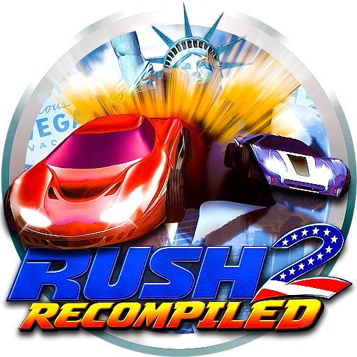

> [!WARNING]
> **This is amazingalek/rush2recompiled-web, a fork, not Rush 2 Recompiled.** Its `main` branch builds the game into a
> web page (WebGPU, through [N64Recomp-browser](https://github.com/amazingalek/N64Recomp-browser)), and everything on
> that branch past upstream's commits was written by AI (Claude). It is not made, endorsed or supported by Rush 2
> Recompiled's author: nothing here is offered upstream, and please don't take issues with this fork to them. Building
> the page: [docs/BUILDING.md](docs/BUILDING.md#the-web-page).
>
> This port is here to build out and test N64Recomp-browser's web support on another game than the ones it was written
> for: what it turns up is fixed there where it can be, so every recomp's page gets the fix.

**Play it in the browser: https://amazingalek.github.io/rush2recompiled-web/**, with your own Rush 2 ROM (US), picked
in the launcher and kept in the browser. It needs WebGPU (Chrome or Edge 113 and up). The page is built from this
branch and published with N64Recomp-browser's `tools/publish_page.sh`, so it can be a commit or two behind. Online
play is the desktop game's only: a browser gives a page no connections to race over.

  

Rush 2: Extreme Racing USA, the 1998 N64 racer, running natively on your PC with widescreen and ultrawide support, high framerates, sharp text, and improved controller support. Add your San Francisco Rush 2049 and San Francisco Rush ROMs and their tracks, cars and modes play right alongside Rush 2's.

You need to bring your own copy of the game. Nothing from the original cartridge is included here.

**Download:** the Windows build and the Linux AppImage are on the [Releases page](https://github.com/bryantmh/rush2recompiled/releases/latest). Every release lists what changed since the last one.

Join the [Discord](https://discord.gg/nYfFAKMnyx) or watch the [YouTube video](https://youtu.be/Dd5F3HraMxA) introducing the project.

## What you get

- **Widescreen.** Play in 4:3 like the original, 16:9, or expand the view to fill whatever window size you like.
- **Smooth framerate.** The game still runs at its original speed of 30fps but interpolated up to any arbitrary framerate, including a variable refresh rate mode that follows your display
- **HUD where you want it.** Keep the speedometer and lap info in the classic 4:3 spot, or push it out to the edges of the screen.
- **No pop-in.** Turn off level of detail and every car and building is drawn at full quality, no matter how far away it is.
- **Crisp fonts.** All the menu text and HUD numbers have been redrawn so they stay sharp at any resolution. You can switch back to the original blurry ones if you miss them.
- **Upscaled textures (optional).** Turn on Texture Upscaling in the graphics settings and the cars and tracks get smoothed at 2x or 4x with HQ2x/HQ4x, the filters emulators use for texture enhancement. The HUD and menus are left alone. Prefer another upscaler, like Topaz Gigapixel? Dump the textures with one click, upscale them with it, and install the results as your own texture pack.
- **Saves that just work.** Your players and records are kept on a virtual Controller Pak, and the save file uses the same format as emulators.
- **Rumble.** Works on any controller that can rumble, alongside saves. Enhanced rumble gives crashes, wall scrapes and screeching tires each their own feel, and the haptics on DualSense (USB), Steam Controller and Steam Deck also shake the side of the car that was hit.
- **Up to 4 players, any controllers.** Xbox, PlayStation and most other controllers work, plus keyboard. Pick which controller belongs to which player and the game remembers it next time.
- **Rebind everything.** The game's own Controls screen now lets you map any button, trigger, stick or key. It shows the right button icons for your controller.
- **Online races.** Up to 8 players on separate computers, on your network or over the internet: host a lobby from the Online tab and share your address, or join one. No server needed. Race, stunt and Rush 2049 battle arenas (docs/online.md).
- **Split screen.** Two player races can run side by side in addition to the original top and bottom.
- **AI opponents.** Choose the car, paint and rims of each computer opponent in the General tab.
- **Ghost races.** Previously a 2049 exclusive feature. Record your runs and race against your own ghost car.
- **Unlocks.** Earn cars, tracks and engines through an UNLOCKS shop. You can disable it and go back to original Rush 2 behavior if you wish.
- **Circuits and records.** Race a circuit of tracks, with its length and custom course pool set in the General tab. The main menu's RECORDS screen lists the records of every course, including the added games' courses.
- **Accurate car stats.** The car select's bars come from the real race physics instead of Rush 2's fixed bars (General tab).
- **Graphics extras.** Optional ambient occlusion shades corners and creases for more depth, and Car Sheen controls the reflections on the cars' paint, including real-time cubemap reflections (Graphics tab).
- **Track and car filter.** Press Y on the track or car select to filter the list by game.
- **Mod support.** Add or create new tracks and cars, swap models and textures, or move the HUD (see [Modding](#modding)).

## Four games in one

Rush 2 Recompiled is also a home for the rest of the series. Add the ROMs for the games below on the Games tab and their tracks, cars, music and mechanics join Rush 2's, all in the same menus and with all the features above. Each ROM is optional and independent of the others; with none, you get Rush 2 on its own.

### San Francisco Rush 2049

Add the Rush 2049 ROM to get:

- **Wings.** Hold the Wings button when you're airborne to pop out wings and glide. They handle just like they did in 2049.
- **The 2049 tracks.** All six race tracks from Rush 2049 show up in the track select
- **The 2049 cars.** All thirteen Rush 2049 cars join the car select after Rush 2's own.
- **The 2049 music.** Each of the six 2049 tracks plays its own Rush 2049 song.
- **The 2049 stunt arenas.** The stunt arenas are playable from the track select.
- **2049 stunt scoring.** Set Stunt Scoring on the Games tab to score tricks the Rush 2049 way: flips, rolls, helicopter spins and wheelies build a combo with a multiplier, and a wreck loses it. The stunt display comes with it.
- **Battle arenas.** Eight deathmatch arenas in the BATTLE row, with weapons, pickups, and arrows pointing to the other cars. Computer-controlled drones can fill the arenas, and weapons can also be turned on in regular arena races with a cheat. The track select's BATTLE row turns any race into a battle race: a row of weapon and power-up pickups on every checkpoint line past the start, and drones that grab them and shoot.
- **Coins.** Collect 2049's coins, which are counted per player in the Progress tab and count toward unlocks.
- **Dreamcast disc (experimental).** Rush 2049 can also be loaded from a Dreamcast disc image instead of the N64 ROM, and a Dreamcast Textures option uses the disc's textures with the N64 version.

### San Francisco Rush

Add the San Francisco Rush ROM on the Games tab to get:

- **The Rush 1 tracks.** All seven race tracks from the original San Francisco Rush.
- **The Rush 1 music.** The nine Rush 1 race songs play on its tracks, picked at random.
- **Rush 1 car decals.** Some of Rush 1's own unique paint jobs are available as a stripe option.
- **Keys.** Collect the keys hidden on the Rush 1 tracks, which are counted per player in the Progress tab and count toward unlocks.

### California Speed (experimental)

California Speed (Atari Games, 1999) runs on the same engine as Rush 2, so it comes across well, but it is the newest addition and still has rough edges. Add the California Speed ROM on the Games tab to get:

- **The California Speed tracks.** All sixteen tracks, from Monterey to Mt. Shasta, Fuji and San Andreas, after the custom tracks in the track select. Its point-to-point courses are raced over one lap.
- **The California Speed cars.** All twenty-one cars join the car select after the other cars. Computer cars can drive them too: on every track, only on California Speed's tracks, or not at all.
- **Road Hold.** California Speed keeps cars on its hills instead of launching them off every crest. This is on by default and can be turned off to use Rush 2's own gravity.
- **The California Speed music.** Its nine songs play on its tracks, picked at random.

## What you need

- A Windows 10 or 11 PC, or a Linux PC (any desktop distro with glibc 2.38 or newer, such as Ubuntu 24.04, Fedora 39, Debian 13, current Arch or SteamOS; see [docs/linux.md](docs/linux.md))
- A graphics card that supports DirectX 12 (Windows) or Vulkan (Windows or Linux); anything from the last several years should be fine
- Your own ROM of **Rush 2: Extreme Racing USA**
- Optional: a ROM of **San Francisco Rush 2049** to play its tracks, cars, arenas and more
- Optional: a ROM of **San Francisco Rush: Extreme Racing** to play its tracks, music and more
- Optional, experimental: a ROM of **California Speed** to play its tracks, cars and music

Each game takes one exact ROM, the North American (USA) release, and other regions or versions are turned away. Check yours against these SHA-1 hashes (of the `.z64` file; `.n64` and `.v64` files of the same ROM work too):

| Game | ROM | Size | SHA-1 (`.z64`) |
|---|---|---|---|
| Rush 2: Extreme Racing USA | Rush 2 - Extreme Racing USA (USA) | 12 MB | `01b0a31b1accc18061e8c85f6c5edf0dbd79f097` |
| San Francisco Rush 2049 (optional) | San Francisco Rush 2049 (USA) | 12 MB | `3f99351d7bb61656614bdb2aa1a90cfe55d1922c` |
| San Francisco Rush: Extreme Racing (optional) | San Francisco Rush - Extreme Racing (USA) | 8 MB | `cc62539cb30b180c3c7e0aa927786ed061d8d9ab` |
| California Speed (optional, experimental) | California Speed (USA) | 16 MB | `bd4c070a71ef58499587cb811fb7490b88dd7c0b` |

## Getting started

1. Download the latest build from the [Releases page](https://github.com/bryantmh/rush2recompiled/releases/latest) and put `Rush2Recompiled.exe` somewhere you like. On Linux, download the AppImage and make it executable (`chmod +x`).
2. Run it.
3. The first time, it'll ask you to find your Rush 2 ROM. Point it at the file and you're in.

After that the game starts right away. It keeps its own copy of the ROM, so you can move or delete the original file if you want.

Shortcut: if you drop the ROM in the same folder as the exe, it'll find it on its own and skip the question.

## Setting things up

Most options live in the settings menu (press Escape, or select).

- **General:** gameplay options, accurate car stats, circuit length and courses, AI opponents' cars, background input and data location
- **Graphics:** window mode, resolution, aspect ratio, framerate, anti-aliasing, level of detail, fonts, texture upscaling, ambient occlusion and car sheen
- **Sound:** race and menu music per game, plus whether other cars' engines are heard
- **Controls:** choose which controllers (and the keyboard) can play, the split screen layout, and each save profile's steering, stick deadzone and rumble settings, with buttons to test each rumble effect
- **Progress:** see the keys and coins you've collected
- **Games:** pick your Rush 2049, San Francisco Rush and California Speed ROMs, then turn on their tracks, cars, Wings and Rush 2049 stunt scoring
- **Cheats:** unlock all tracks and cars, plus driving, survival, race and visual cheats. Turn on Enable Cheat Menu first (see [docs/cheats.md](docs/cheats.md)).
- **Online:** host or join a lobby (see below)

Mods are managed from the **Mods** menu.

To change your button layout, use the game's own **Controls** screen, under Setup or from the pause menu. Pick a row, press A, then press the button you want for it.

## Online multiplayer (experimental)

Up to 8 players can race on separate computers, on the same network or over the internet. There's no server: one player hosts a lobby and the others connect straight to them. Race, stunt and Rush 2049 battle arenas all work, and so do custom tracks as long as everyone has the mod.

- **Host:** open Settings > Online and press Host Lobby. Pick the number of players and the port (UDP 47100 by default) first if you want something else. The game asks your router to open the port by itself (UPnP) and shows the address to give your friends. If your router doesn't support that, forward the port by hand.
- **Join:** lobbies on your own network are listed in the Online tab with a Join button. For anyone else, type the host's address into Join by Address.
- **Play:** the host goes through the game's normal menus and everyone else follows along. Each player picks their own profile and car. The race starts once everyone is ready and has the track. While you're in a lobby, the gameplay settings are the host's, and yours come back when you leave.

Everyone needs the same version of the game, and a copy of any ROM the chosen track needs (for example Rush 2049 for its tracks). Every computer runs the whole race itself and only controller inputs are sent, so a steady connection matters more than a fast one. This is still new: expect lots of rough edges.

## Where your stuff is saved

Settings and saves live in `%LOCALAPPDATA%\Rush2Recompiled`. Paste that into the File Explorer address bar to get there.

Your saves are in the `saves` folder: `rush2.n64.us.mpk` (the game's own save), `rush2.n64.us.json` (records, cars, keys, coins and unlocks of the added games) and `ghosts`. Back the folder up if you care about your records.

Texture upscaling keeps its files in the `texture_upscale` folder there: the upscaled textures it has made (so nothing is upscaled twice), and the `dump` and `upscaled` folders for your own upscales.

Want to keep everything on a USB stick or next to the game? Turn on portable mode in the General tab under Data Location. Your data moves into the game's folder the next time you launch.

## Modding

Rush 2 Recompiled supports mods for tracks, cars, models, textures and the HUD. A mod is a folder (or a zipped `.rtz`) holding a `mod.json` in the `mods` folder; turn it on in the Mods menu. Install ones other people have made or build your own.

### Replacing models (experimental)

Any model in the game can be swapped for your own mesh. Run Dump Models to get every model as a `.glb` in `asset_dump/models`, edit it in Blender or a similar program, export it as glTF Binary with textures embedded and no Draco compression, and keep the dumped file name. Put it under `rush2/models/` in a mod (with `"game_id": "rush2"` in its `mod.json`), for example `rush2/models/tracks/ALCATRAZ/ALCATRAZL4156.glb`. Only the look changes: cars and tracks still drive and collide as before. A whole car can go in `rush2/cars/<CAR>.glb`, where it takes the player's paint and dents; `tools/car_mod.py` can build that from a mesh and texture.

### New cars

A mod can add whole new cars to the car select, each from a `.glb` and a short `.json` under `rush2/new_cars/` (name, base car, wheel positions, colors and any physics you want to set). `rush2/liveries/` adds extra looks to an existing car through a STYLE row. See [docs/car_mods.md](docs/car_mods.md). `tools/arcade2049/car_mod.py` builds a mod with the San Francisco Rush 2049 arcade's Truck, Deuce and Caddy and its arcade-only color schemes.

### Replacing textures

In Settings > Graphics, under Your Own Upscales, press Dump Textures to write every texture in your ROMs as a `.png` to `asset_dump/textures`. Edit or upscale them with any tool, save them under `asset_dump/user_texture_pack`, and press Install Upscaled Textures. That builds `mods/rush2_custom_textures.rtz`, turns it on, and is the one file to share. Car bodies are dumped painted violet, yellow and cyan to show where the player's paint goes; keep those areas apart. See [docs/texture_upscaling.md](docs/texture_upscaling.md).

### Custom tracks

Build a track in Blender, mark its surfaces, finish line and checkpoints by object name, draw the racing line, and export it as `track.glb` with a short `track.toml` beside it. Put them under `rush2/tracks/<your track>/` in a mod. The game converts the track, lists it on the track select, and writes a report of anything wrong to the `track_reports` folder. Custom tracks race forward, backward or mirrored, with computer opponents, records and ghosts. Preview one without starting the game with [Trackview](docs/custom_tracks.md#previewing-your-track). The full guide is [docs/custom_tracks.md](docs/custom_tracks.md).

### HUD layout

Move, resize or hide any part of the race HUD, separately for each split screen layout and race mode, with the HUD editor. It needs Python and a build of the HUD previewer (see [docs/hud_layout.md](docs/hud_layout.md#hud-editor)). Run `python tools/hud_preview/editor.py --mods <your mods folder>`, open the address it prints, and press Save as Mod when you're done. Turn the mod on in the Mods menu; the game picks up new saves within a couple of seconds.

## Credits

Built with [N64Recomp](https://github.com/N64Recomp/N64Recomp), [N64ModernRuntime](https://github.com/N64Recomp/N64ModernRuntime), [RecompFrontend](https://github.com/N64Recomp/RecompFrontend) and the [RT64](https://github.com/rt64/rt64) renderer. Texture upscaling uses [hqx](https://github.com/grom358/hqx) (LGPL 2.1, in `lib/hqx`). Big thanks to everyone behind those projects.

Track banner images for the San Francisco Rush tracks and Rush 2049's Metro and Presidio by Bunny.

Rush 2 Recompiled logo by POOTERMAN
https://www.deviantart.com/pooterman

Rush 2 and Rush 2049 belong to their respective owners. This project isn't affiliated with them and doesn't include any of their game data.

Curious how it works or want to build it yourself? See [docs/BUILDING.md](docs/BUILDING.md).
